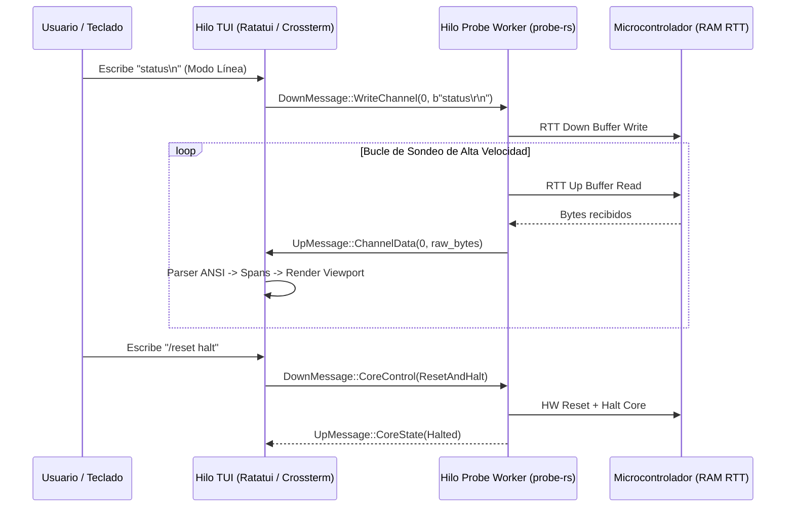

# Documento de Requerimientos y Descripción del Proyecto (PRD)

**Proyecto:** Terminal RTT Interactiva (`rtt-terminal`)  
**Organización:** Samay  
**Estado:** Especificación de Requerimientos y Diseño Funcional  
**Versión:** 1.0.0  
**Fecha:** 11 de Septiembre de 2026  

---

## 1. Visión y Descripción General

### 1.1 Propósito del Producto
`rtt-terminal` es una herramienta de línea de comandos e interfaz de texto interactiva (TUI) de alto rendimiento, diseñada para desarrolladores de firmware y sistemas embebidos. Su función principal es proporcionar una comunicación bidireccional en tiempo real con microcontroladores mediante la tecnología **SEGGER RTT (Real Time Transfer)** a través de sondas de depuración (priorizando Segger J-Link, y extendiéndose a CMSIS-DAP y ST-Link).

### 1.2 Motivación y Justificación
Las herramientas tradicionales de RTT (como *J-Link RTT Viewer* o clientes Telnet básicos) presentan limitaciones notables:
- Dependencia de software propietario pesado instalado en la máquina del desarrollador.
- Clientes de terminal crudos sin historial de comandos, autocompletado ni soporte ergonómico para múltiples canales.
- Pobre manejo de caídas de conexión cuando el microcontrolador se reinicia, se reprograma o entra en modos de bajo consumo.
- Dificultad para alternar entre shells interactivas carácter por carácter y envíos de línea estructurados.

`rtt-terminal` soluciona estos problemas combinando la potencia y seguridad de **Rust**, una arquitectura de conexión de hardware dual (enlace oficial con **Segger J-Link DLL** para multiplexación y coexistencia transparente con herramientas como VS Code, nRF Connect y Power Profiler, más soporte multiprobe con **`probe-rs`**) y una interfaz moderna estilo **Ratatui**, inspirada en la ergonomía de las CLI modernas asistidas por comandos slash (`/`).

---

## 2. Alcance del Proyecto (Scope)

### 2.1 En Alcance (In-Scope)
- **Enlace oficial con Segger J-Link DLL (`JLink_x64.dll` / `JLinkARM.dll`):** Comunicación nativa que convive armónicamente con herramientas activas (VS Code, nRF Connect, Power Profiler Kit) utilizando el driver oficial de Segger (`jlink.sys`) sin requerir conversiones destructivas de driver vía Zadig.
- **Multiplexación y Cero Conflictos:** Capacidad de abrir la terminal RTT mientras el firmware se flashea desde VS Code o se alimenta con el Power Profiler.
- **Compatibilidad multiprobe:** Soporte para CMSIS-DAP y ST-Link mediante `probe-rs`.
- **Detección automática** del bloque de control RTT (`_SEGGER_RTT`) en la memoria RAM del microcontrolador.
- **Interfaz de terminal interactiva (TUI)** de vista única enfocada.
- **Entrada dual:**
  - **Modo Línea:** Edición de comandos, historial persistente, autocompletado y comandos slash (`/`).
  - **Modo Raw (`/raw`):** Transmisión inmediata carácter por carácter para shells integradas (Micropython, Zephyr Shell, FreeRTOS CLI).
- **Soporte multicanal:** Canales Up y Down del canal 0 al 15, con visualización en texto UTF-8 o Hexdump.
- **Decodificación ANSI en tiempo real:** Interpretación de colores y estilos emitidos por el firmware.
- **Timestamps configurables:** Marcas de tiempo locales milimétricas opcionales.
- **File Logging:** Volcado en vivo de la sesión hacia archivos en disco.
- **Control de hardware del target:** Comandos para `reset`, `halt` (pausa) y `run` (reanudar).
- **Resiliencia y auto-reconexión configurable:** Recuperación automática ante reinicios del micro.
- **Modo de inicio híbrido:** Flags de línea de comandos para automatización o asistente interactivo con búsqueda difusa (fuzzy search) de chips soportados.
- **Binario único portátil:** Generación de un `.exe` autocontenido para Windows.

### 2.2 Fuera de Alcance para la v1.0 (Out-of-Scope)
- Flasheo o programación de binarios en memoria Flash (se delega a `cargo-flash` o `probe-rs run`).
- Servidor GDB integrado (para depuración paso a paso por breakpoints).
- Gráficas bidimensionales de telemetría en tiempo real (consideradas para v2.0).

---

## 3. Pila Tecnológica y Dependencias

| Componente | Tecnología Seleccionada | Justificación |
| :--- | :--- | :--- |
| **Lenguaje** | Rust (Edición 2024, MSRV 1.85+) | Seguridad de memoria, alto rendimiento, nuevo resolver v3 de Cargo, concurrencia sin data races y binario único. |
| **Backend de Hardware** | **Segger J-Link DLL (`libloading`)** + `probe-rs` | Integración oficial con la DLL de Segger (`JLink_x64.dll`) para compatibilidad directa con el driver `jlink.sys`, multiplexación con VS Code/Power Profiler y APIs RTT nativas; más `probe-rs` para sondas universales. |
| **Interfaz de Usuario** | `ratatui` + `crossterm` | Renderizado TUI moderno, reactivo, con soporte completo de eventos de teclado y mouse. |
| **Parsing de CLI** | `clap` (derive) | Parseo robusto y tipado de argumentos de línea de comandos. |
| **Búsqueda Difusa** | `fuzzy-matcher` | Algoritmo de filtrado ultrarrápido para seleccionar chips entre el catálogo de `probe-rs`. |
| **Procesamiento ANSI** | `ansi-to-tui` o parser especializado | Traducción de secuencias de escape ANSI a estilos nativos de `ratatui::text::Span`. |
| **Tiempo y Fechas** | `chrono` | Formateo preciso de timestamps con resolución de milisegundos. |
| **Concurrencia** | `crossbeam-channel` | Canales de comunicación lock-free entre el hilo de hardware RTT y el hilo de la TUI. |

---

## 4. Requerimientos Funcionales (RF)

### 4.1 Conexión y Detección de Hardware
- **RF-01 (Detección de Sondas):** El sistema debe listar todas las sondas de depuración conectadas (identificando fabricante, modelo y número de serie).
- **RF-02 (Selección de Microcontrolador):**
  - Si el usuario suministra el flag `--chip <NOMBRE>`, el sistema debe validar e iniciar conexión inmediatamente.
  - Si no se suministra, el sistema debe abrir un modal interactivo que permita escribir y filtrar difusamente (fuzzy search) entre todas las familias y variantes soportadas por `probe-rs` (e.g. `nRF52840_xxAA`, `STM32F401RE`, `RP2040`, `ESP32-S3`).
- **RF-03 (Detección del Bloque de Control RTT):** Una vez conectado al target vía SWD/JTAG, el sistema debe escanear la RAM del chip para localizar el símbolo `_SEGGER_RTT`. Si la búsqueda falla inicialmente, debe reintentar periódicamente sin congelar la UI.

### 4.2 Canales RTT y Streaming de Datos
- **RF-04 (Gestión Multicanal):** El sistema debe soportar hasta 16 canales Up (lectura) y 16 canales Down (escritura). Por defecto, el canal activo debe ser el canal 0.
- **RF-05 (Cambio de Canal en Caliente):** El usuario debe poder conmutar el canal RTT visible mediante el comando `/channel <n>` o `/c <n>`.
- **RF-06 (Modo Hexdump):** Para canales que transmitan tramas binarias o telemetría no imprimible en UTF-8, el sistema debe permitir alternar entre vista de texto y vista hexdump con `/hex`.

### 4.3 Experiencia de Entrada del Usuario
- **RF-07 (Modo Línea con Comandos Slash):**
  - Todo texto ingresado que **no** inicie con `/` se enviará directamente al Down-channel del microcontrolador al pulsar `Enter`.
  - Todo texto que inicie con `/` será interceptado como un comando interno de la aplicación.
  - Al escribir `/`, la TUI debe desplegar un menú flotante con los comandos disponibles y permitir autocompletado con `Tab`.
  - Navegación por historial de envíos previos mediante flechas `Arriba` / `Abajo`.
- **RF-08 (Modo Raw Interactivo):**
  - Mediante el comando `/raw`, la terminal entrará en modo carácter por carácter: cada pulsación de tecla se enviará de inmediato al microcontrolador.
  - El usuario podrá salir del modo raw de vuelta al modo línea mediante una secuencia de escape definida (`Ctrl+]` o `Esc`).
- **RF-09 (Configuración de Terminador de Línea):** El comando `/eol <crlf|lf|cr|none>` permitirá definir los bytes de final de línea enviados en modo línea.

### 4.4 Visualización y Registro de Logs
- **RF-10 (Colores y Estilos ANSI):** La terminal debe interpretar los códigos de color ANSI (16 colores, 256 colores y TrueColor) y estilos (negrita, atenuado, subrayado) emitidos por el firmware.
- **RF-11 (Timestamps Locales):** El usuario podrá activar/desactivar marcas de tiempo locales `[HH:MM:SS.mmm]` mediante `/timestamps [on|off]`.
- **RF-12 (Grabación a Archivo - File Logging):** El usuario podrá iniciar la grabación de logs a un archivo en disco con `/log start <ruta>` y detenerla con `/log stop`.

### 4.5 Resiliencia y Control del Microcontrolador
- **RF-13 (Comandos de Control de Core):**
  - `/reset [halt|run]`: Provoca un reinicio del sistema/hardware del microcontrolador.
  - `/halt`: Pausa la ejecución de la CPU.
  - `/run`: Reanuda la ejecución de la CPU.
- **RF-14 (Auto-Reconexión Configurable):** Si el micro se reinicia o el bloque de control RTT se invalida temporalmente, el motor de fondo debe reintentar la sincronización sin que la aplicación se cierre. El usuario podrá alternar este comportamiento con `/autoreconnect [on|off]`.

---

## 5. Requerimientos No Funcionales (RNF)

- **RNF-01 (Rendimiento y Desacoplamiento de Hilos):** El bucle de lectura de hardware RTT debe ejecutarse en un hilo de fondo dedicado, independiente del hilo de renderizado de la UI. La TUI debe mantenerse fluida a 60 FPS incluso bajo ráfagas intensas de logs (>500 KB/s).
- **RNF-02 (Uso Eficiente de Memoria):** El buffer de logs visuales en pantalla debe estar implementado como un *Ring Buffer* de tamaño acotado y configurable (por defecto 10,000 líneas) para evitar consumo ilimitado de RAM.
- **RNF-03 (Portabilidad y Empaquetado):** La aplicación debe compilarse en un único archivo ejecutable nativo (`rtt-terminal.exe` en Windows), sin exigir runtime de Python, DLLs externas ni instalación del Segger J-Link SDK.
- **RNF-04 (Tolerancia a Fallos):** Desconexiones físicas del cable USB de la sonda no deben provocar un `panic` en Rust; la aplicación debe mostrar una advertencia clara en el header e intentar reenganchar al reinsertar la sonda.

---

## 6. Catálogo de Comandos Slash (`/`)

| Comando | Sintaxis | Descripción |
| :--- | :--- | :--- |
| `/help` | `/help` | Muestra la ventana modal con la lista de comandos y atajos de teclado. |
| `/channel` | `/channel <0-15>` o `/c <n>` | Cambia el canal RTT activo a monitorear y transmitir. |
| `/raw` | `/raw` | Entra al modo interactivo carácter a carácter. Salir con `Ctrl+]`. |
| `/timestamps` | `/timestamps [on\|off]` | Activa o desactiva la inserción de timestamps en la visualización. |
| `/log` | `/log <start\|stop\|status> [path]` | Inicia, detiene o consulta el guardado de la sesión en disco. |
| `/clear` | `/clear` | Limpia las líneas del buffer visual en pantalla. |
| `/reset` | `/reset [halt\|run]` | Ejecuta un reset de hardware en el target. Por defecto reinicia en modo ejecución (`run`). |
| `/halt` | `/halt` | Detiene (pausa) la ejecución del microcontrolador. |
| `/run` | `/run` | Reanuda la ejecución del microcontrolador. |
| `/autoreconnect` | `/autoreconnect [on\|off]` | Activa o desactiva el reintento automático de conexión ante reinicios del target. |
| `/eol` | `/eol <crlf\|lf\|cr\|none>` | Modifica la secuencia de fin de línea agregada al presionar `Enter`. |
| `/hex` | `/hex` | Conmuta entre la vista de texto decodificado y visualizador Hexdump. |
| `/quit` | `/quit` o `/exit` | Desconecta la sonda de forma limpia y cierra la aplicación. |

---

## 7. Diseño de la Interfaz de Usuario (TUI Layout)

```
┌─ rtt-terminal ── [Probe: J-Link Plus (SN: 12345678)] ── [Target: nRF52840_xxAA] ── [Status: RUNNING] ─┐
│ Active Channel: CH0 (Terminal) │ EOL: CRLF │ Timestamps: ON │ Auto-Reconnect: ON │ Log: session.log   │
├───────────────────────────────────────────────────────────────────────────────────────────────────────┤
│ [11:42:01.120] <info> app: System initialized. Firmware v2.1.0                                       │
│ [11:42:01.125] <info> sensor: Calibrating IMU sensor...                                              │
│ [11:42:01.350] <info> sensor: IMU OK (Offset: 0.02, -0.01, 1.00)                                     │
│ [11:42:02.000] <warning> ble: Waiting for BLE connection...                                           │
│ [11:42:02.450] <info> ble: Connected to peer 4A:21:88:9C:12:00                                       │
│ [11:42:02.455] <info> net: MTU exchanged: 247 bytes                                                  │
│                                                                                                       │
│                                                                                                       │
├───────────────────────────────────────────────────────────────────────────────────────────────────────┤
│ [/channel  ] [/raw      ] [/reset    ] [/timestamps] [/log      ] [/help     ]                        │
│ > /_                                                                                                  │
└───────────────────────────────────────────────────────────────────────────────────────────────────────┘
```

1. **Header (Barra Superior):** Muestra el estado de la sonda USB (`Probe`), chip target (`Target`), estado del core (`RUNNING`, `HALTED`), canal activo (`Active Channel`), modo `EOL`, `Timestamps`, `Auto-Reconnect` y archivo de registro (`Log`).
2. **Body (Área de Logs):** Historial con scroll bidireccional (Mouse wheel, `PageUp`/`PageDown`), renderizado ANSI fiel y opción de búsqueda.
3. **Completions Bar (Popup / Sugerencias):** Barra contextual que sugiere comandos cuando el usuario escribe `/`.
4. **Footer / Input Prompt:** Campo de edición de comandos con cursor, historial de líneas (`↑`/`↓`) y soporte para comandos o envío de texto plano.

---

## 8. Arquitectura de Hilos y Manejo de Concurrencia



---

## 9. Criterios de Aceptación y Validación

1. **Detección sin dependencias externas:** El programa debe detectar un Segger J-Link conectado por USB en Windows sin requerir la suite de software Segger instalada en el PATH del sistema.
2. **Localización de RTT:** Al especificar un microcontrolador (e.g. `nRF52840_xxAA`), el sistema debe encontrar el bloque `_SEGGER_RTT` y comenzar a mostrar datos en menos de 2 segundos tras el arranque.
3. **Fidelidad de Texto y Colores:** Textos con secuencias de escape estándar ANSI (e.g. `\x1b[32mOK\x1b[0m`) deben renderizarse en el color respectivo sin imprimir caracteres de control rotos.
4. **Bidireccionalidad:** El envío de comandos debe ser recibido e interpretado por el microcontrolador de forma inmediata.
5. **Estabilidad ante Reset:** Al disparar un `/reset` o resetear manualmente el micro mediante el pulsador físico de la placa de desarrollo, la terminal no debe cerrarse; debe notificar el evento y reanudar la lectura en cuanto el firmware reinicie RTT.
