# Plan de Implementación Incremental por Etapas

**Proyecto:** Terminal RTT Interactiva (`rtt-terminal`)  
**Ecosistema:** Rust 2024 (MSRV 1.85+)  
**Estrategia:** Desarrollo iterativo con validación obligatoria en cada hito antes de avanzar.

---

## Resumen de Etapas

| Etapa | Nombre | Foco Principal | Mecanismo de Validación |
| :---: | :--- | :--- | :--- |
| **1** | **Andamiaje, CLI y Detección de Hardware** | Estructura Cargo, CLI con `clap`, detección USB y base de datos de chips. | Tests unitarios + CLI listing (`--list-probes`, `--chip`). |
| **2** | **Motor RTT Headless (Consola Base)** | Conexión SWD/JTAG, búsqueda de `_SEGGER_RTT`, lectura y escritura RTT básica. | Prueba bidireccional CLI directa con el microcontrolador físico. |
| **3** | **Esqueleto de la TUI (Ratatui)** | Layout visual en inglés (Header, Log Viewport, Prompt), bucle de render a 60 FPS y Mock Provider. | Ejecución en modo mock sin hardware (`--mock`) + pruebas de navegación y resize. |
| **4** | **Renderizado ANSI, Timestamps y File Logging** | Parser ANSI a estilos Ratatui, marcas de tiempo milimétricas y volcado a disco. | Tests unitarios de secuencias de color + inspección de archivo de log generado. |
| **5** | **Comandos Slash (`/`) y Autocompletado** | Parser de comandos, menú emergente reactivo, tecla `Tab` e historial de líneas. | Tests unitarios de dispatch + navegación interactiva en la TUI. |
| **6** | **Modo Raw y Control de Hardware** | Streaming carácter por carácter (`/raw`), `/reset`, `/halt`, `/run` y auto-reconexión. | Prueba con shell del firmware + test de reset físico/software con reenganche. |
| **7** | **Selector Interactivo Inicial y Release** | Asistente de inicio con búsqueda difusa de chips y empaquetado del binario único `.exe`. | Ejecución limpia sin argumentos + build optimizado (`cargo build --release`). |

---

## Detalle de las Etapas de Implementación

### Etapa 1: Andamiaje, CLI y Detección de Hardware

#### 1.1 Objetivo
Configurar el proyecto en Rust 2024 con todas las dependencias base, definir los argumentos de línea de comandos mediante `clap` y desarrollar el módulo de sondeo para listar sondas USB conectadas y validar la existencia de chips soportados mediante búsqueda difusa.

#### 1.2 Entregables de Código
- `Cargo.toml`: Configuración de Rust 2024 (resolver v3) y dependencias: `probe-rs`, `clap`, `fuzzy-matcher`, `crossbeam-channel`, `anyhow`.
- `src/main.rs`: Punto de entrada que procesa los argumentos de CLI.
- `src/cli.rs`: Estructura tipada con `clap` (`--list-probes`, `--probe`, `--chip`, `--speed`, `--mock`).
- `src/probe/targets.rs`: Módulo que consulta el catálogo de chips de `probe-rs` y expone un buscador difuso.
- `src/probe/detector.rs`: Funciones para listar sondas J-Link / CMSIS-DAP conectadas por USB con su Serial Number y fabricante.

#### 1.3 Criterios de Validación (Cómo Probarlo)
1. **Pruebas Automatizadas:**
   ```bash
   cargo test
   ```
   - Tests unitarios verificando que el buscador difuso encuentre variantes correctas (ej. buscar `"nrf52840"` debe retornar `"nRF52840_xxAA"`).
   - Tests unitarios del parseo de flags CLI válidas e inválidas.
2. **Prueba con Hardware:**
   ```bash
   cargo run -- --list-probes
   ```
   - Debe listar en consola la sonda Segger J-Link conectada (Vendor, Modelo, Serial).
3. **Prueba de Validación de Chip:**
   ```bash
   cargo run -- --chip nRF52840_xxAA
   ```
   - Debe confirmar que el chip es válido en la base de datos de `probe-rs` y reportar la arquitectura (Cortex-M4, etc.).

---

### Etapa 2: Motor RTT Headless (Consola Base)

#### 2.1 Objetivo
Establecer una sesión de depuración con el microcontrolador físico mediante `probe-rs`, localizar el bloque de control `_SEGGER_RTT` en la memoria RAM y verificar la lectura y escritura RTT continua en una consola headless básica (sin TUI aún), garantizando que la capa de bajo nivel es 100% funcional.

#### 2.2 Entregables de Código
- `src/probe/session.rs`: Inicialización de sesión SWD/JTAG a la velocidad configurada.
- `src/probe/rtt.rs`: Enlace con el bloque `_SEGGER_RTT` en RAM y manejo de canales Up (lectura) y Down (escritura).
- `src/probe/worker.rs`: Hilo de fondo que realiza polling continuo sin saturar la CPU y se comunica mediante canales de mensajes (`crossbeam-channel`).
- Modo de prueba en `main.rs`: Si se pasa `--headless`, corre un puente directo entre RTT y stdout/stdin de la terminal estándar.

#### 2.3 Criterios de Validación (Cómo Probarlo)
1. **Prueba de Recepción (Up Channel):**
   ```bash
   cargo run -- --chip <TU_CHIP> --headless
   ```
   - Con el microcontrolador ejecutando un firmware que emita mensajes por RTT (ej: `SEGGER_RTT_WriteString(0, "Hello\n")`), los mensajes deben imprimirse de inmediato en la terminal.
2. **Prueba de Transmisión (Down Channel):**
   - Escribir una cadena en la consola y pulsar `Enter`.
   - El firmware del microcontrolador debe recibir los bytes por el canal Down 0 y procesarlos o hacer eco.
3. **Prueba de Resistencia:**
   - Dejar corriendo el flujo continuo durante 2 minutos y verificar que la memoria RAM del proceso en la PC permanezca constante.

---

### Etapa 3: Esqueleto de la TUI (Ratatui) y Modo Simulado (Mock)

#### 3.1 Objetivo
Implementar la interfaz de texto interactiva (TUI) completa con `ratatui` y `crossterm`, reflejando exactamente el diseño acordado en inglés, con un bucle de eventos desacoplado a 60 FPS, manejo seguro de la terminal (restauración ante cierre) y un generador de logs simulados para poder validar la UI sin depender del hardware físico.

#### 3.2 Entregables de Código
- `src/tui/app.rs`: Estructura `AppState` (líneas de log en buffer circular de 10,000 elementos, estado de conexión, canal activo, contenido del input prompt).
- `src/tui/ui.rs`: Renderizado del layout:
  - Header superior en inglés: `[Probe: ...] [Target: ...] [Status: RUNNING]`, `Active Channel: CH0`, etc.
  - Viewport central de logs con soporte de scroll vertical.
  - Footer con barra de entrada (`> `) y cursor visible.
- `src/tui/events.rs`: Gestor de eventos de teclado, ratón y tick de reloj a través de `crossterm`.
- `src/mock.rs`: Emisor de logs de prueba que genera mensajes continuos para validar la TUI.

#### 3.3 Criterios de Validación (Cómo Probarlo)
1. **Prueba Visual sin Hardware (Mock Mode):**
   ```bash
   cargo run -- --mock
   ```
   - Se abre la pantalla completa de la TUI con el layout en inglés.
   - Los logs simulados fluyen suavemente por la pantalla.
2. **Prueba de Scroll y Navegación:**
   - Utilizar la rueda del ratón o las teclas `PageUp` / `PageDown`: el auto-scroll debe pausarse al navegar hacia arriba y reanudarse al volver al final.
3. **Prueba de Edición de Input:**
   - Escribir texto en el prompt inferior, usar `Backspace`, flechas `Izquierda`/`Derecha`, `Home`, `End`.
4. **Prueba de Salida Limpia:**
   - Presionar `Ctrl+C`: la terminal debe restaurar el modo original de la consola sin dejar artefactos visuales ni romper el cursor de Windows.

---

### Etapa 4: Renderizado ANSI, Timestamps y File Logging

#### 4.1 Objetivo
Garantizar la visualización fiel de los estilos y colores emitidos por el microcontrolador (decodificando secuencias ANSI estándar), añadir marcas de tiempo locales opcionales y permitir la grabación continua de la sesión a archivos en disco.

#### 4.2 Entregables de Código
- `src/tui/ansi.rs`: Parser que transforma cadenas con secuencias ANSI (`\x1b[31m`, `\x1b[1m`, etc.) a tipos nativos `ratatui::text::Line` y `Span`.
- Soporte para Timestamps locales con formato `[HH:MM:SS.mmm]` (utilizando `chrono`).
- `src/logging.rs`: Sistema de escritura de logs a archivo en segundo plano, no bloqueante para la UI.
- Flags CLI opcionales: `--log <archivo>` y `--timestamps`.

#### 4.3 Criterios de Validación (Cómo Probarlo)
1. **Pruebas Automatizadas del Parser ANSI:**
   ```bash
   cargo test tui::ansi
   ```
   - Comprobación de secuencias de color foreground, background y resets (`\x1b[0m`).
2. **Prueba Visual de Colores:**
   - Enviar desde el firmware (o en modo mock) líneas con tags: `<info>` en verde, `<warning>` en amarillo, `<error>` en rojo.
   - Validar que los colores se muestran nítidos en el viewport sin caracteres extraños impresos.
3. **Prueba de File Logging:**
   ```bash
   cargo run -- --mock --log test_session.log --timestamps
   ```
   - Cerrar tras unos segundos y abrir `test_session.log`: verificar que las líneas registradas contienen los timestamps y el texto plano decodificado.

---

### Etapa 5: Sistema de Comandos Slash (`/`) y Autocompletado

#### 5.1 Objetivo
Incorporar la experiencia interactiva mediante comandos de control con prefijo `/`, desplegando una barra contextual emergente con sugerencias, autocompletado con `Tab` e historial de navegación de comandos previos con flechas `↑`/`↓`.

#### 5.2 Entregables de Código
- `src/commands/mod.rs`: Parser e intérprete de comandos slash:
  - `/help`: Abre un popup modal flotante con la guía de comandos y atajos.
  - `/channel <n>` o `/c <n>`: Cambia el canal activo en la vista.
  - `/clear`: Limpia las líneas del buffer visible.
  - `/timestamps [on|off]`: Conmuta las marcas de tiempo en pantalla.
  - `/log <start|stop|status> [ruta]`: Controla la grabación a archivo en caliente.
  - `/eol <crlf|lf|cr|none>`: Cambia el terminador de línea.
  - `/hex`: Alterna entre vista de texto y visor hexdump.
  - `/quit`: Salida limpia.
- `src/commands/completions.rs`: Motor de sugerencias y autocompletado con tecla `Tab`.
- `src/tui/history.rs`: Historial de comandos ingresados navegable con flechas arriba/abajo.

#### 5.3 Criterios de Validación (Cómo Probarlo)
1. **Pruebas Automatizadas de Comandos:**
   ```bash
   cargo test commands
   ```
   - Tests de parseo: comandos válidos, errores de sintaxis y autocompletado.
2. **Prueba Interactiva del Popup de Sugerencias:**
   - En el prompt de la TUI, escribir `/`: debe aparecer sobre el prompt la barra de sugerencias con `/channel`, `/help`, `/log`, etc.
   - Escribir `/ch` y presionar `Tab`: debe autocompletar a `/channel `.
3. **Prueba de Comandos en Caliente:**
   - Ejecutar `/help`: se abre el modal interactivo con la ayuda; presionar `Esc` o `Enter` lo cierra.
   - Ejecutar `/channel 1`: el header superior actualiza inmediatamente a `Active Channel: CH1`.
   - Ejecutar `/clear`: el viewport de logs se vacía al instante.

---

### Etapa 6: Modo Raw y Control de Hardware del Microcontrolador

#### 6.1 Objetivo
Habilitar el modo de entrada carácter por carácter (`/raw`) para interactuar con shells del microcontrolador en tiempo real, e integrar los comandos de control físico de hardware (`/reset`, `/halt`, `/run`) junto con la máquina de auto-reconexión resiliente ante reinicios.

#### 6.2 Entregables de Código
- Modo `/raw`:
  - Al ejecutar `/raw`, el prompt inferior cambia de apariencia (`[RAW MODE - Press Ctrl+] or Esc to exit]`).
  - Cada tecla pulsada se envía directamente al canal Down RTT sin esperar a `Enter`.
- Integración con APIs de hardware de `probe-rs`:
  - `/reset [halt|run]`: Ejecuta `target.reset()` o `target.reset_and_halt()`.
  - `/halt`: Pausa la ejecución del microcontrolador.
  - `/run`: Reanuda la ejecución del firmware.
- Máquina de estados de resiliencia (`src/probe/reconnect.rs`):
  - Detección de pérdida de sincronismo RTT o reinicio del micro.
  - Si `/autoreconnect` está en `ON`, reintenta encontrar el bloque `_SEGGER_RTT` sin abortar la aplicación.

#### 6.3 Criterios de Validación (Cómo Probarlo)
1. **Prueba de Modo Raw:**
   - Ejecutar `/raw` con un microcontrolador que ejecute una shell interactiva (Zephyr Shell, FreeRTOS CLI o MicroPython).
   - Escribir comandos y verificar que cada carácter hace eco en vivo. Presionar `Ctrl+]` y verificar que regresa al modo línea habitual.
2. **Prueba de Control de Hardware:**
   - Ejecutar `/reset`: verificar visualmente en la placa de desarrollo que el micro se reinicia y los logs de arranque vuelven a fluir.
   - Ejecutar `/halt`: el firmware se congela y el header muestra `[Status: HALTED]`.
   - Ejecutar `/run`: el firmware continúa su ejecución y el header muestra `[Status: RUNNING]`.
3. **Prueba de Auto-Reconexión:**
   - Con `/autoreconnect on`, pulsar el botón físico de reset de la placa.
   - La terminal debe mostrar un aviso de reconexión y reanudar la impresión de logs en cuanto la RAM vuelva a inicializarse, sin crasheos.

---

### Etapa 7: Selector Interactivo Inicial y Empaquetado Release

#### 7.1 Objetivo
Desarrollar el asistente visual interactivo que se muestra al iniciar sin flags de línea de comandos (para escanear sondas conectadas y buscar interactivamente el chip target mediante fuzzy search), y generar el binario único optimizado para distribución.

#### 7.2 Entregables de Código
- `src/tui/wizard.rs`: Modal de configuración inicial:
  - Paso 1: Lista de sondas USB detectadas seleccionable con flechas.
  - Paso 2: Buscador difuso en vivo para seleccionar el microcontrolador de entre la base de datos de `probe-rs`.
- Configuración de optimización en `Cargo.toml`:
  ```toml
  [profile.release]
  opt-level = 3
  lto = true
  codegen-units = 1
  panic = "abort"
  strip = true
  ```

#### 7.3 Criterios de Validación (Cómo Probarlo)
1. **Prueba del Asistente Interactivo:**
   ```bash
   cargo run
   ```
   - Sin pasar `--chip` ni `--probe`, la TUI inicia con el asistente interactivo.
   - Seleccionar la sonda con las flechas y presionar `Enter`.
   - Escribir en el buscador (ej: `stm32f4`) y ver cómo la lista filtra en tiempo real. Seleccionar y conectar.
2. **Compilación de Release:**
   ```bash
   cargo build --release
   ```
   - Verificar que se genera un único archivo ejecutable `target/release/rtt-terminal.exe`.
   - Comprobar que el tamaño del binario sea contenido y que corra de forma autónoma sin dependencias externas.

---

## Flujo de Trabajo para Avanzar Entre Etapas

```mermaid
graph LR
    E1[Etapa 1: CLI & Sondas] -->|Validado con tests y hardware| E2[Etapa 2: RTT Headless]
    E2 -->|Validado I/O con micro| E3[Etapa 3: TUI & Mock]
    E3 -->|Validado layout y UX| E4[Etapa 4: ANSI & Logs]
    E4 -->|Validado fidelidad visual| E5[Etapa 5: Slash Commands]
    E5 -->|Validada interactividad| E6[Etapa 6: Raw & Reset]
    E6 -->|Validado control de core| E7[Etapa 7: Wizard & Release]
```



Cada etapa se desarrollará de forma aislada, se ejecutará su protocolo de validación y **solo tras tu confirmación expresa pasaremos a la siguiente etapa**.
